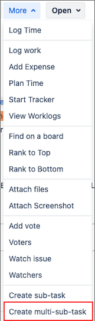
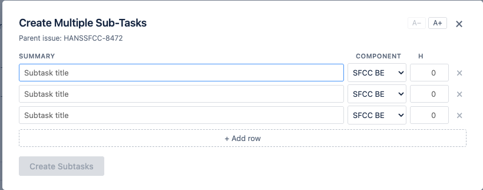

# Jira Bulk Subtask Creator

A Chrome extension that adds a **"Create multi-sub-task"** option to the Jira issue More dropdown, letting you create multiple subtasks at once instead of one at a time.

## Features

- Adds "Create multi-sub-task" immediately after "Create sub-task" in the More dropdown
- Each subtask has its own **Summary**, **Component**, and **Estimate (hours)** fields
- Components are loaded live from your Jira project — no hardcoded list
- Start with 3 rows; add more with `+ Add row` or by pressing Enter in the estimate field
- Per-row progress tracking — each row shows ✅ with a link on success or ❌ with the error on failure
- Individual row errors don't stop the rest — partial success is handled gracefully
- **Zoom in/out** — `A−` / `A+` buttons in the modal header scale the entire modal for screen sharing; zoom level is remembered between sessions
- **Keyboard shortcuts** — press `-` to zoom out, `+` to zoom in (when not typing in an input), `Escape` to close
- Works across SPA navigation (no page reload needed when switching issues)
- Compatible with Jira Software Data Center and Server, classic AUI-based UI

## Requirements

- Any **HTTPS Jira instance** — the extension activates on pages whose URL matches `/browse/PROJ-123` and whose page metadata identifies them as Jira
- **Chrome** browser (any recent version)
- Must be **logged into Jira** — the extension uses your existing browser session (no credentials are stored or sent anywhere)

## Installation

1. Download or clone this repository
2. Open **`chrome://extensions`** in Chrome
3. Enable **Developer mode** (toggle in the top-right corner)
4. Click **Load unpacked** and select the `jira-helpers` folder
5. **Recommended:** click **Details** on the extension card → under **Site access** choose **On specific sites** → add your Jira instance URL (e.g. `https://jira.example.com`). This limits the extension to only your Jira domain.
6. The extension is now active

## Usage

1. Navigate to any Jira issue page (URL contains `/browse/PROJ-123`)
2. Click the **More** dropdown button
3. Click **"Create multi-sub-task"**
4. Fill in the rows — each row has:
   - **Summary** — the subtask title
   - **Component** — click the field or the **▾** chevron to open the dropdown; click any component to add it as a tag. Click a tag's **×** to remove it. The list is loaded from your Jira project.
   - **h** — original estimate in hours (optional)
5. Add more rows with `+ Add row` or by pressing **Enter** in the estimate field
6. Click **"Create N Subtasks"**
7. Watch per-row progress — each row transforms to a result in place
8. Click **"Reload to see subtasks"** to refresh the issue page when done

## Zoom for screen sharing

During planning meetings where you share your screen, use the zoom controls to make the modal readable for everyone:

- Click **A+** in the modal header (or press `+`) to zoom in — 4 levels up to 1.6×
- Click **A−** (or press `-`) to zoom out
- The zoom level is saved automatically and restored the next time you open the modal
- `-` / `+` only trigger zoom when a text input is **not** focused, so they still type normally in the Summary field

## Troubleshooting

**"Create multi-sub-task" doesn't appear in the More menu**
- Reload the extension: go to `chrome://extensions`, find the extension, click the reload icon
- Hard-refresh the Jira page (Cmd+Shift+R on Mac / Ctrl+Shift+R on Windows)
- Check the browser console (F12 → Console) for error messages
- Confirm the URL contains `/browse/PROJ-123`

**Error: HTTP 403**
Your Jira session may have expired. Refresh the Jira page to log in again, then retry.

**Error: No subtask issue type found**
The project may not have subtasks enabled, or your account may not have permission to create them. Contact your Jira administrator.

**Error: Failed to fetch / network error**
Check your network connection and confirm the Jira instance is reachable.

**Component dropdown shows "Loading components…" and never populates**
The extension couldn't reach the Jira components API. Check your network connection and confirm you're logged in. If the problem persists, the modal will show an error banner — subtasks can still be created without a component selected.

## Privacy

All API calls are made directly to your Jira instance using your existing browser session. No data is sent to any external service. The extension has no analytics, no telemetry, and no external dependencies. Zoom preference is stored in the browser's `localStorage` for that Jira origin only.
